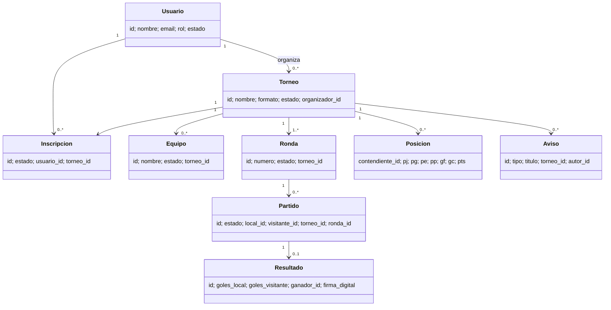
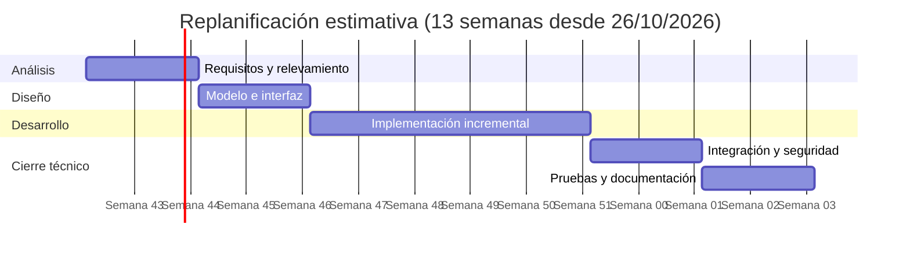

# Ingeniería de software — especificación y planificación

**Proyecto:** Tornalyx (SGDM) · **Versión documental:** 1.0 · **Fecha:** 26/10/2026

Este complemento describe el producto implementado. La planificación temporal que sigue es una línea base de referencia; debe ajustarse con fechas y responsables reales del equipo antes de presentarse como seguimiento histórico.

## ESRE resumida (IEEE 29148)

### Propósito, alcance y definiciones

El sistema permite a participantes consultar torneos, solicitar inscripción, consultar calendario y posiciones, y administrar su perfil. Organizadores gestionan torneos propios, aceptan participantes, generan fixture, programan encuentros y cargan resultados. Administradores mantienen cuentas y documentación. Público consulta torneos publicados. El producto es una aplicación web PHP/MVC con MySQL; los sistemas externos de correo y hosting quedan fuera del control del sistema.

**Términos:** fixture = conjunto de emparejamientos; ronda = etapa del fixture; bye = descanso/avance sin partido; organizador = propietario de un torneo; OTP = clave temporal de un solo uso.

### Requisitos funcionales

| ID | Requisito | Prioridad |
|---|---|---|
| RF-01 | El sistema permitirá registrar una cuenta con datos válidos y contraseña almacenada con hash seguro. | Alta |
| RF-02 | El sistema permitirá iniciar sesión y completar el segundo factor por correo cuando esté configurado. | Alta |
| RF-03 | El participante podrá consultar torneos públicos y solicitar inscripción. | Alta |
| RF-04 | El organizador podrá crear y administrar únicamente sus torneos. | Alta |
| RF-05 | El organizador podrá aprobar/rechazar solicitudes y generar fixture de liga, eliminación o suizo. | Alta |
| RF-06 | El organizador podrá programar partidos y registrar o corregir sus resultados. | Alta |
| RF-07 | El sistema calculará posiciones desde los resultados registrados. | Alta |
| RF-08 | El sistema emitirá avisos asociados a eventos relevantes del torneo. | Media |
| RF-09 | El usuario podrá gestionar perfil público y datos sociales opcionales. | Media |
| RF-10 | El administrador podrá gestionar usuarios y aprobar solicitudes de acceso a documentación. | Media |
| RF-11 | Cuando se configure una clave RSA, el sistema firmará resultados y permitirá verificar la firma pública. | Media |

### Requisitos no funcionales

| ID | Requisito verificable |
|---|---|
| RNF-01 Seguridad | Toda operación de cambio requiere sesión/CSRF y autorización de objeto en servidor. |
| RNF-02 Seguridad | Contraseñas con `password_hash`; consultas persistentes parametrizadas con PDO. |
| RNF-03 Confidencialidad | Producción pública se sirve sobre HTTPS y secretos se configuran fuera de Git. |
| RNF-04 Compatibilidad | Debe ejecutarse con PHP 8.2+, PDO MySQL y Apache con rewrite/headers; MySQL 8 compatible. |
| RNF-05 Portabilidad | El entorno local se levanta con Docker Compose desde un checkout limpio. |
| RNF-06 Fiabilidad | Las posiciones derivan de resultados guardados; restricciones únicas impiden duplicar inscripción/resultado. |
| RNF-07 Mantenibilidad | Separación MVC y reglas de fixture aisladas de la capa HTTP. |
| RNF-08 Usabilidad | Los flujos principales deben poder completarse desde móvil y escritorio; validar con encuesta y pruebas manuales. |

**Limitaciones:** el correo depende del proveedor configurado; sin las claves privadas no se generan firmas; la disponibilidad, copias y seguridad de red dependen del hosting.

## Casos de uso

| ID | Actor | Caso | Precondición | Flujo principal |
|---|---|---|---|---|
| CU-01 | Público | Consultar torneo | Torneo publicado | Buscar torneo → ver detalle, partidos y posiciones |
| CU-02 | Participante | Inscribirse | Sesión activa, inscripción abierta | Solicitar lugar → consultar estado de solicitud |
| CU-03 | Organizador | Gestionar inscripción | Es propietario del torneo | Revisar solicitud → aprobar o rechazar |
| CU-04 | Organizador | Generar fixture | Al menos dos contendientes aprobados | Elegir formato → generar rondas → publicar aviso |
| CU-05 | Organizador | Registrar resultado | Partido de torneo propio | Cargar marcador → guardar → recalcular posiciones |
| CU-06 | Visitante | Verificar firma de resultado | Resultado disponible y clave pública configurada | Solicitar verificación → recibir estado válido/inválido/sin firma |
| CU-07 | Administrador | Administrar usuario | Sesión administrativa | Buscar cuenta → cambiar estado/rol permitido → guardar |
| CU-08 | Usuario | Consultar documento restringido | Sesión activa y acceso aprobado | Solicitar OTP → verificar OTP → leer documento |

## Modelo de clases (vista de dominio)

## Factibilidad resumida

| Dimensión | Evaluación |
|---|---|
| Técnica | Viable con PHP, MySQL y Apache disponibles; despliegue reproducible mediante Docker. Requiere gestión externa de TLS, backup, monitoreo y correo. |
| Operativa | Flujos distinguen público, participante, organizador y administrador; requiere capacitación breve y soporte del equipo. |
| Económica | La base tecnológica es de código abierto. El costo real depende de hosting, dominio, correo, almacenamiento/backups y horas de mantenimiento; cotizar proveedor antes de comprometer presupuesto. |
| Legal | Perfiles y datos personales requieren minimización, consentimiento/aviso, control de acceso y retención conforme a normativa aplicable. Validar con referente institucional. |

## Contingencia

| Incidente | Respuesta inicial | Recuperación |
|---|---|---|
| Aplicación no disponible | Revisar health check y logs; detener despliegue defectuoso | Volver al último artefacto estable y verificar flujos críticos |
| Base no disponible | Confirmar conectividad/TLS y estado del proveedor | Restablecer servicio; no borrar ni recrear almacenamiento sin backup verificado |
| Pérdida/corrupción de datos | Suspender escrituras afectadas y preservar evidencia | Restaurar backup en instancia aislada, validar integridad y luego conmutar |
| Cuenta comprometida | Suspender cuenta, revocar sesiones y rotar credenciales afectadas | Revisar auditoría, restaurar acceso mínimo y notificar según política |
| Clave privada de firma expuesta | Deshabilitar firma y proteger resultados nuevos | Generar nuevo par, publicar nueva clave y marcar periodo/firma anterior como comprometido |
| Correo/OTP fuera de servicio | Informar indisponibilidad y revisar proveedor | Recuperar API/credenciales; no desactivar controles en producción sin aprobación institucional |

## Estimación de puntos de función (preliminar)

Conteo indicativo de funciones visibles, complejidad media asumida; no es medición auditada IFPUG. Complejidad media: EI=4, EO=5, EQ=4, ILF=10, EIF=7.

| Tipo | Conteo estimado | Peso medio | Puntos |
|---|---:|---:|---:|
| Entradas externas (EI) | 14 | 4 | 56 |
| Salidas externas (EO) | 8 | 5 | 40 |
| Consultas externas (EQ) | 10 | 4 | 40 |
| Archivos lógicos internos (ILF) | 12 | 10 | 120 |
| Archivos de interfaz externa (EIF) | 2 | 7 | 14 |
| **Total preliminar** |  |  | **270 PF** |

Recontar con requisitos validados, límites de aplicación y complejidad baja/media/alta revisada por el equipo.

## Cronograma de referencia

| Fase | Duración estimada | Salida |
|---|---:|---|
| Requisitos y relevamiento | 2 semanas | ESRE, casos de uso y aceptación |
| Diseño de datos e interfaz | 2 semanas | Modelo relacional, prototipo y arquitectura |
| Implementación incremental | 5 semanas | Autenticación, torneos, inscripciones, fixtures y resultados |
| Integración y seguridad | 2 semanas | Migraciones, permisos, hardening y despliegue |
| Pruebas y documentación | 2 semanas | Casos ejecutados, manuales y entrega |

Las fechas de inicio, integrantes responsables, progreso real y dependencias deben completarse con actas/plan del equipo; este cronograma es estimativo.

